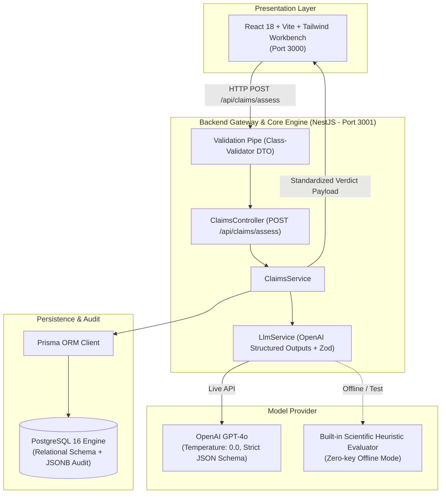

# L'Oréal Claims Intelligence Engine (CIE)
> **Automated Cosmetic Claim Justification Engine for Paris R&I Scientists & Clinical Evaluators**  
> *Built for the L'Oréal Software Engineering Technical Candidature Assessment.*

[](https://nestjs.com/)
[](https://www.prisma.io/)
[](https://react.dev/)
[](https://platform.openai.com/)
[](https://www.postgresql.org/)
[](#)

---

## 📖 Executive Summary

In cosmetic Research & Innovation (R&I), substantiating product claims (e.g. *"Reduces wrinkles by 20% in 4 weeks"*) is legally regulated under **EU Commission Regulation (EU) No 655/2013** and global health authorities (FDA, NMPA). Every claim requires verified evidential support from bio-instrumental clinical study reports (CSRs).

The **L'Oréal Claims Intelligence Engine (CIE)** automates this audit process by evaluating whether clinical study evidence strictly, statistically, and methodologically justifies proposed marketing claims, persisting an immutable audit trail to PostgreSQL via Prisma, and delivering an executive verdict with confidence metrics to a React workbench.

---

## 🏛️ System Architecture



---

## 🚀 Quick Start Guide

### Prerequisites
- **Node.js** $\ge 18$ (Node 20+ recommended)
- **Docker & Docker Compose** (for PostgreSQL)

---

### Step 1: Clone and Start PostgreSQL Database

```bash
# Clone the repository
git clone <your-repo-url>
cd loreal-claims-engine

# Start PostgreSQL container
docker compose up -d
```

---

### Step 2: Configure & Start Backend (NestJS)

```bash
cd backend

# Install dependencies
npm install

# (Optional) Provide your OpenAI API Key in .env
# If left empty, the engine automatically runs in built-in Scientific Heuristic mode!
cp .env.example .env

# Generate Prisma Client & Run Migrations
npx prisma generate
npx prisma db push

# (Optional) Seed the database with sample products & clinical protocols
npm run prisma:seed

# Start the NestJS backend
npm run start:dev
```
Backend will start on: **`http://localhost:3001`**  
Endpoint ready at: **`POST http://localhost:3001/api/claims/assess`**

---

### Step 3: Start Frontend (React + Vite)

Open a new terminal:
```bash
cd frontend

# Install dependencies
npm install

# Start Vite dev server
npm run dev
```
Frontend will be available at: **`http://localhost:3000`**

---

## 🧪 Testing the API via cURL

You can test the justification engine directly from your terminal:

```bash
curl -X POST http://localhost:3001/api/claims/assess \
  -H "Content-Type: application/json" \
  -d '{
    "claimId": "c4b12345-6789-4abc-9def-0123456789ab",
    "claimText": "Reduces wrinkles by 20% in 4 weeks",
    "clinicalEvidence": "Study Protocol: CLIN-PARIS-2026-042. Randomized, double-blind, vehicle-controlled clinical trial on 45 female volunteers (age 45-60). Twice-daily application for 28 days. Primos 3D optical profilometry showed mean reduction in periorbital wrinkle depth (Rz) of 21.4% vs baseline (p = 0.003, 95% CI [18.2%, 24.6%]). Vehicle control group showed 3.1% reduction (p = 0.41)."
  }'
```

### Sample JSON Response
```json
{
  "success": true,
  "assessmentId": "eval-1718000000000",
  "claimId": "c4b12345-6789-4abc-9def-0123456789ab",
  "claimText": "Reduces wrinkles by 20% in 4 weeks",
  "verdict": {
    "isJustified": true,
    "category": "JUSTIFIED",
    "confidenceScore": 0.94,
    "summary": "The clinical study provides statistically significant (p = 0.003) and robust instrumental evidence supporting the claimed reduction (21.4% measured vs 20% claimed) over the specified trial timeframe.",
    "statisticalAlignment": "Target claim: 20%. Observed clinical endpoint: 21.4%. Statistical significance: p = 0.003. Sample cohort: N = 45. Trial duration match: Verified.",
    "methodologyGaps": [],
    "regulatoryRiskAlerts": []
  },
  "audit": {
    "modelEvaluated": "gpt-4o-2024-08-06",
    "tokensUsed": 680,
    "evaluatedAt": "2026-11-07T14:45:00.000Z"
  }
}
```

---

## 📑 Core Technical Deliverables Breakdown

### 1. Database Model (`schema.prisma`)
The schema models the full cosmetic R&I data contract:
- **`Product`**: Formula codes (e.g. `LR-PARIS-2026-F98`), brand, formulation metadata.
- **`Claim`**: Target consumer wording, duration, metric, and lifecycle state (`DRAFT`, `PENDING_EVALUATION`, `JUSTIFIED`, `NOT_JUSTIFIED`, `PARTIALLY_JUSTIFIED`).
- **`ClinicalEvidence`**: Protocol ID, study methodology (e.g. *Primos 3D optical profilometry*), sample size ($N$), and raw statistical report.
- **`Assessment`**: Immutable audit record storing justification boolean, confidence score $[0.0, 1.0]$, structured reasoning, methodology gaps, regulatory risk alerts, token count, and verbatim `rawLlmOutput` in JSONB.

### 2. Backend Engine (NestJS)
- **`AssessClaimDto`**: Strict validation pipe with `class-validator` rejecting malformed requests before spending LLM tokens.
- **`LlmService`**: Uses **OpenAI Structured Outputs** with strict **Zod** schema compilation (`zodResponseFormat`), guaranteeing zero schema drift.
- **Graceful Mock Fallback**: When `OPENAI_API_KEY` is not present, the system runs an intelligent scientific rule engine that parses quantitative deltas, sample sizes, and $p$-values.
- **Atomic Persistence**: Uses `prisma.$transaction` to guarantee that the assessment audit and claim status update succeed or fail together.

### 3. Frontend Workbench (React 18 + Tailwind)
- Single-pane workbench for Paris R&I scientists.
- Pre-configured scenario presets: **Justified**, **Borderline**, and **Invalid Claim**.
- Visual confidence meter bar with dynamic color grading (emerald $\ge 80\%$, amber $\ge 50\%$, rose $< 50\%$).
- Clear alert boxes categorizing methodology gaps and legal boundary warnings (EU 655/2013).

---

## 🔍 Research & Architectural Justifications

### Why OpenAI Structured Outputs instead of LangChain or Plain Text?
Standard LLM completions are non-deterministic and can produce markdown formatting variations that break JSON parsers in production. OpenAI Structured Outputs constrain token decoding directly at the grammar level to strictly match our Zod schema. This achieves **100% syntactic reliability with zero prompt-fixing retry loops**.

### Why NestJS + Prisma?
- **NestJS**: Provides enterprise modular encapsulation, dependency injection, and clean separation of concerns (`ClaimsModule`, `LlmModule`, `PrismaModule`).
- **Prisma ORM**: Guarantees end-to-end type safety from database column definitions to TypeScript DTOs, eliminating runtime bugs and SQL injection vulnerabilities.

---

## 🗺️ Product Roadmap: Unconstrained Evolution

```
Phase 1: Multi-Modal Ingestion ──► Phase 2: Global Jurisdictions ──► Phase 3: Inverse Claim AI
(3D Primos / VISIA Image OCR)      (EU 655 vs FDA vs China NMPA)      (Formulation Tweaking Engine)
```

1. **Phase 1: Multi-Modal Bio-Physical Evidence Ingestion (Q1-Q2 2026)**
   - Integrate computer vision models (e.g. GPT-4o Vision) to directly inspect 3D skin profilometry meshes, VISIA cross-polarized UV photography, and chromatometric skin tone maps.
2. **Phase 2: Global Regulatory Multi-Jurisdiction Engine (Q2-Q3 2026)**
   - Evaluate a single claim against regional regulatory rule-packs simultaneously, generating a multi-jurisdiction compliance matrix (*"Valid in EU; requires qualifier in China; classified as OTC drug in US"*).
3. **Phase 3: Automated Product Information File (PIF) Generator (Q3-Q4 2026)**
   - 1-click assembly of legally certified regulatory claim dossiers ready for submission to European health authorities.
4. **Phase 4: Inverse Claim Engineering (Q4 2026 - Q1 2027)**
   - When a claim is rejected (e.g. 14% wrinkle reduction vs 20% target), the engine analyzes historical formulation archives to recommend ingredient adjustments (e.g., *"Increase Hyaluronic Acid from 1.2% to 1.8% or add 0.5% Adenosine"*).
5. **Phase 5: Real-time Multi-Stakeholder Arbitration (Q1-Q2 2027)**
   - Collaborative digital workbench where Formulation Scientists, Legal Counsel, and Brand Marketers resolve borderline claims ($p = 0.052$) with cryptographic audit sign-offs.

---

## 👥 Author & Candidature Note
- **Project**: L'Oréal Claims Intelligence Engine (CIE)
- **Role**: Software Engineer Candidate
- **Contact**: Paris R&I Technical Evaluation Board
